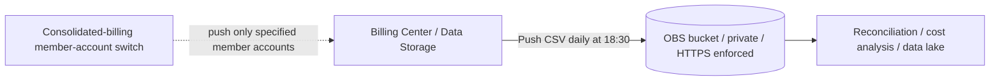

# lean-governance-cost-data-export · Filter and Archive Detailed Data by Account to OBS


## 1. Overview

### Overview

This practice introduces a solution on Huawei Cloud that **automatically archives cost/billing detail data by a specified range of member accounts to Object Storage Service (OBS) daily**, for reconciliation, usage analysis, and long-term retention. It leverages the Billing Center's native "Data Storage" capability combined with the consolidated-billing member-account switch to achieve "filter by account" with zero code and a lightweight footprint.

---

## 2. Table of Contents

- [1. Overview](#1-overview)
- [2. Table of Contents](#2-table-of-contents)
- [3. Architecture Diagram](#3-architecture-diagram)
- [4. Highlights](#4-highlights)
- [5. Cloud Services Used](#5-cloud-services-used)
- [6. Prerequisites](#6-prerequisites)
- [7. Quick Start](#7-quick-start)
- [8. Step-by-Step Deployment](#8-step-by-step-deployment)
- [9. Usage / Verification](#9-usage--verification)
- [10. Cleanup](#10-cleanup)
- [11. Detailed Explanation](#11-detailed-explanation)
- [12. Dependencies](#12-dependencies)
- [13. FAQ / Troubleshooting](#13-faq--troubleshooting)
- [14. Contributing](#14-contributing)
- [15. License](#15-license)
- [16. Contact / Maintainers](#16-contact--maintainers)

```
├── infra/                  # Terraform infrastructure
│   ├── main.tf
│   ├── variables.tf
│   ├── outputs.tf
│   └── versions.tf
├── src/                    # Business code (incl. subscription verification script)
├── docs/                   # Documentation
│   ├── architecture.md
│   ├── deployment-guide.md
│   └── obs-bucket-policy-gotchas.md
├── deploy.sh               # Deployment entrypoint
├── accounts.csv            # Member account list
└── README.md
```

---

## 3. Architecture Diagram



---

## 4. Highlights

- **Zero code**: bill delivery is hosted natively by the Billing Center's "Data Storage"; no functions or pipelines to write.
- **Filter by account**: the consolidated-billing master account enables "Save bills of consolidated member accounts = Yes", so only specified member accounts' bills are archived.
- **Secure and compliant**: OBS bucket set to private + HTTPS enforced + least-privilege bucket policy.
- **One-command IaC**: Terraform manages the OBS bucket and bucket policy, reproducible and destroyable.

---

## 5. Cloud Services Used

- OBS (Object Storage Service)
- Billing Center "Data Storage"

---

## 6. Prerequisites

- Huawei Cloud account with Billing Center and OBS operation permissions (master account, or `BSS Administrator` / `OBS Administrator`).
- To "filter by member account", the current account must be the **consolidated-billing master account**.
- Locally installed: Terraform >= 1.5.0, Python >= 3.8 (verify script optional).
- Credentials provided via environment variables (**never written to files**): `HW_ACCESS_KEY`, `HW_SECRET_KEY`, `HW_REGION_NAME`.

---

## 7. Quick Start

```bash
export HW_ACCESS_KEY="<HW_ACCESS_KEY>"
export HW_SECRET_KEY="<HW_SECRET_KEY>"
export HW_REGION_NAME="cn-north-4"

# Preview (default: init + plan only, no resources created)
./deploy.sh --bucket <globally-unique-bucket-name> --region cn-north-4

# After confirming, actually create
./deploy.sh --bucket <globally-unique-bucket-name> --region cn-north-4 --apply
```

---

## 8. Step-by-Step Deployment

1. Set the Huawei Cloud AK/SK/Region environment variables.
2. Run `./deploy.sh --bucket <bucket-name> --region <region>` for a plan preview.
3. After confirming, add `--apply` to actually create resources.
4. In the Billing Center "Data Storage" console, enable the subscription (including SMS verification).
5. After 18:30 daily, run verify_bills.py to verify delivery.

---

## 9. Usage / Verification

### Usage / Verification

First enable bill data storage subscription in the Billing Center, then use `src/subscription/verify_bills.py` to verify delivery after each daily push, as described below.

1. In the Billing Center "Data Storage", set the bucket above and enable the subscription (including SMS verification; the consolidated-billing master account enables the member-account switch). See `docs/deployment-guide.md`.
2. After the daily 18:30 push, run the verification script to confirm delivery:

```bash
pip install esdk-obs-python
export OBS_SERVER="obs.cn-north-4.myhuaweicloud.com"
python3 src/subscription/verify_bills.py --bucket <bucket-name> --prefix cost-export/ --days 3
# Expected: ✅ N bill objects detected; data storage delivery is effective.
```

After deployment, follow these steps to verify that the business functionality works before considering the delivery complete.

---

## 10. Cleanup

```bash
cd infra
terraform destroy -var="bucket_name=<bucket-name>" -var="region=cn-north-4"
```

And click **Disable** in the Billing Center "Data Storage" to stop bill pushing.

---

## 11. Detailed Explanation

- Architecture and capability differences: `docs/architecture.md`
- Step-by-step deployment and offline initialization: `docs/deployment-guide.md`

---

## 12. Dependencies

### Dependencies and references

- Huawei Cloud Terraform Provider (`huaweicloud` >= 1.96.0)
- `esdk-obs-python` (optional dependency for the verify script)

---

## 13. FAQ / Troubleshooting

### FAQ

- **Verification fails when enabling "Data Storage"**: follow the Billing Center guidance to supplement the bucket policy grant (or set `var.account_id` and explicitly grant the tenant domain write access in the bucket policy).
- **No bill files in the bucket**: confirm the subscription is enabled and bill types are selected; push occurs daily at 18:30, so fetch data after 20:00.
- **Non-consolidated-billing account**: only its own bills are available; "filter by member account" becomes all of its own bills.

---

## 14. Contributing

Issues and PRs are welcome. Please follow the repository's existing directory structure and code style.

---

## 15. License

This practice is licensed under MIT No Attribution. See [LICENSE](LICENSE).

---

## 16. Contact / Maintainers
| Item | Content |
|---|---|
| **Creator** | [dgc-git](https://github.com/dgc-git) |
| **Maintainer** | [dgc-git](https://github.com/dgc-git) |
| **Contact** | GitHub Issues / PR (see [Section 14](#14-contributing)) |
