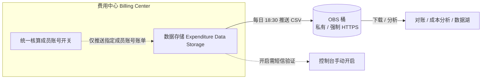

# 明细数据按账号筛选归档到 OBS

## 简介

本实践介绍一种在华为云上**把明细数据按指定成员账号范围，每日自动归档到对象存储（OBS）**的方案，便于下游数据分析与长期留存。

核心能力：

- 利用**费用中心「数据存储」（Expenditure Data Storage）**，将每日账单明细以 CSV 自动投递到指定 OBS 桶；
- 通过**统一核算主账号的「保存统一核算成员账号的账单 = 是」**开关，实现"只归档指定成员账号的账单"——等价于按账号筛选；
- OBS 桶**私有 + 强制 HTTPS + 最小授权桶策略**，保证账单数据安全。

## 架构图

## 组件说明

| 组件 | 华为云服务 | 作用 |
|-|-|-|
| 账单数据源 | 费用中心「数据存储」 | 将每日账单明细（资源账单 / 明细账单等）投递到 OBS |
| 账号筛选 | 统一核算成员账号开关 | 主账号开启后，仅把纳入统一核算的成员账号账单推送到桶 |
| 归档存储 | OBS 桶（私有） | 接收并按日存放账单 CSV 文件 |
| 访问控制 | OBS 桶策略 | 强制 HTTPS（拒绝非 TLS）；授权账单投递以租户身份写入 |
| 取数/验证 | OBS SDK / 控制台 | 每日 20:00 后从桶下载，或运行 `verify_bills.py` 校验投递 |

## 投递文件约定

费用中心「数据存储」按所选账单类型生成文件，常见命名：

- `Spendings(ByResource)_YYYYMMDD` —— 资源账单（按资源）
- `Resource_Expenditures_YYYYMMDD` —— 资源用量支出（旧版）
- 新版格式：`%账号名%_InstanceBillMonth_YYYYMM`、`%账号名%_PriceFactorBillDetail_YYYYMMDD`

文件均为 CSV，按日生成（月初 3 日生成上月全量）。

## 能力边界与适用场景

本实践以华为云**原生数据订阅能力**实现"按账号筛选 + 对象存储归档"，其能力特性如下：

| 维度 | 本实践实现 |
|-|-|
| 筛选方式 | 统一核算成员账号开关（控制台维度筛选） |
| 输出格式 | CSV |
| 数据字段 | 费用中心固定数据字段 |
| 刷新频率 | 每日 18:30 推送 |
| 代码量 | 托管服务，零代码（仅 Terraform 管桶） |

> 本实践采用零代码的托管方案；如需更灵活的筛选与格式能力，可在此基础上引入函数计算与 API 进行扩展。
